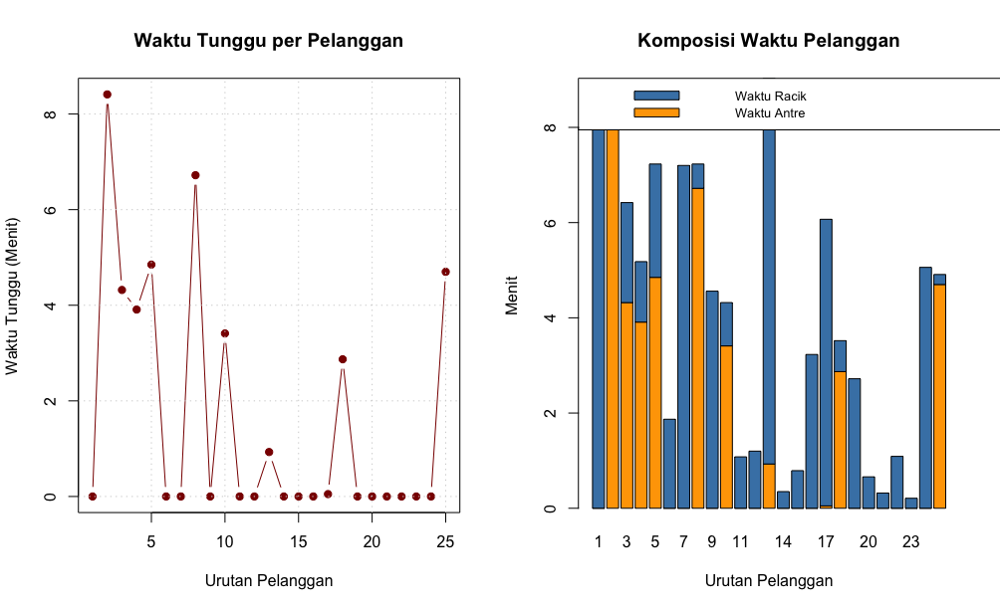

# Simulasi Monte Carlo: Antrean Kedai Kopi (M/M/1 Queue)

Proyek ini dibuat untuk memenuhi tugas mata kuliah **Simulasi & Pemodelan**. Sistem memodelkan antrean pelanggan tunggal (*Single-Server Queue*) di kedai kopi menggunakan bangkitan bilangan acak berdistribusi Eksponensial dengan bahasa pemrograman **R**.

## Parameter Pemodelan
* **Jumlah Pelanggan ($N$):** 25 pelanggan
* **Rata-rata Waktu Antar-Kedatangan:** 3,0 menit ($\lambda = 1/3$ pelanggan/menit)
* **Rata-rata Durasi Pelayanan Barista:** 2,5 menit ($\mu = 1/2,5$ pelanggan/menit)

## Visualisasi Hasil Simulasi

## Cara Menjalankan Kode
1. Buka file `simulasi_antrean.R` menggunakan **RStudio**.
2. Blok seluruh kode (`Command + A`) lalu klik **Run** (`Command + Enter`).
